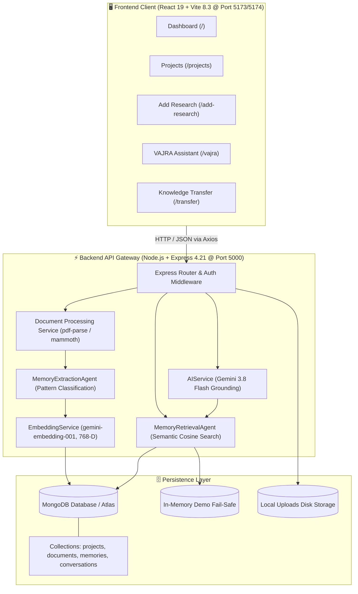
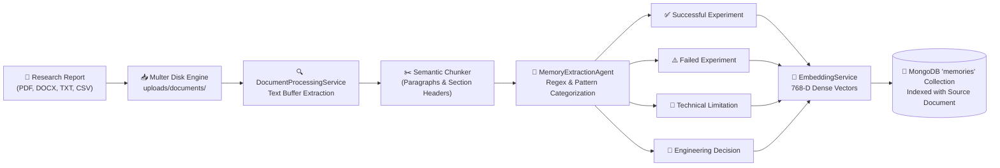
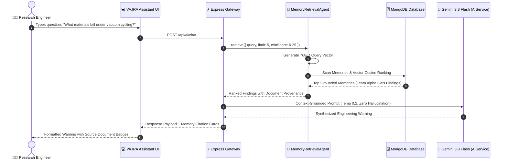
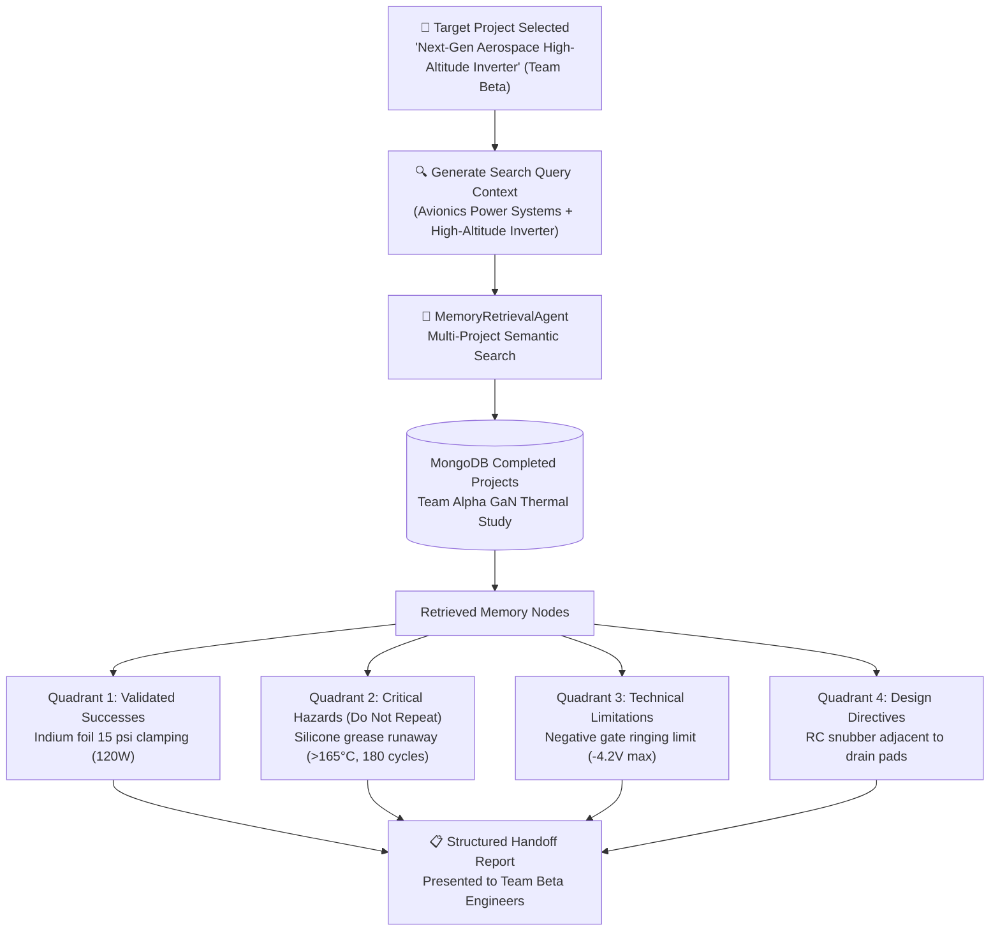
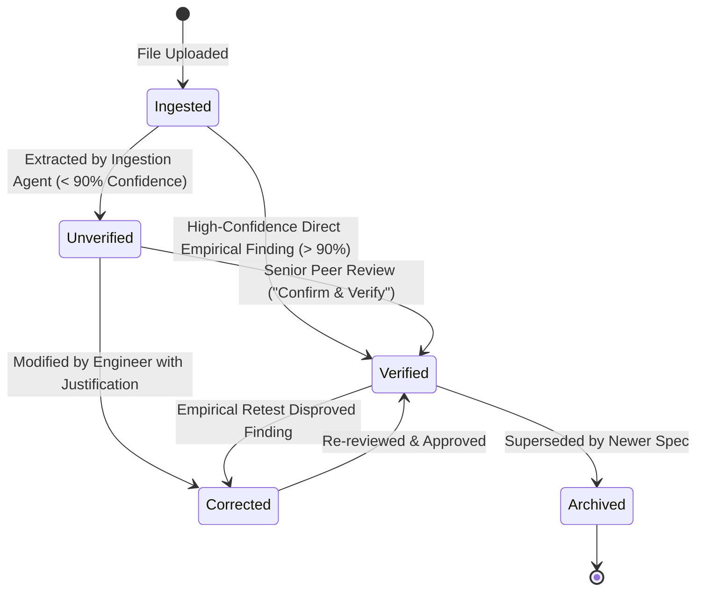

# 🛡️ SiliconSentinel & VAJRA Agentic Memory Engine
## Complete Platform Architecture, Interactive Flowcharts, Technical Operations & Live Demo Guide

> **Track:** PS1 — Track 1: Agentic Memory (NEXUS UNCHARTED 2026, SVNIT Surat)  
> **Team:** Team MC  
> **Lead Researcher & Engineer:** Keshav Gattani (`gattanikeshav15-max`)  
> **Institution:** Sardar Vallabhbhai National Institute of Technology (SVNIT), Surat  
> **Organizers:** Department of Computer Science & Engineering (DoCSE) and Department of AI (DoAI), SVNIT Surat  
> **Collaborators:** MongoDB & n8n  

---

## 📑 Quick Navigation
1. [Executive Summary & What We Are Building](#1-executive-summary--what-we-are-building)
2. [Why SiliconSentinel? Why Not Just Ask Gemini or ChatGPT?](#2-why-siliconsentinel-why-not-just-ask-gemini-or-chatgpt)
3. [Technical Execution: How the Website Runs & Both Technical Sides](#3-technical-execution-how-the-website-runs--both-technical-sides)
4. [System Architecture & Visual Flowcharts](#4-system-architecture--visual-flowcharts)
   - [End-to-End System Architecture](#41-end-to-end-system-architecture)
   - [Document Ingestion & Multi-Agent Extraction Flowchart](#42-document-ingestion--multi-agent-extraction-flowchart)
   - [VAJRA Semantic Retrieval & Grounded RAG Loop](#43-vajra-semantic-retrieval--grounded-rag-loop)
   - [Knowledge Transfer 4-Quadrant Synthesis Engine](#44-knowledge-transfer-4-quadrant-synthesis-engine)
   - [Memory Verification & Peer-Review Lifecycle](#45-memory-verification--peer-review-lifecycle)
5. [The 5 Core Functional Frontend Modules](#5-the-5-core-functional-frontend-modules)
6. [Step-by-Step Live Demo Script (Hackathon Walkthrough)](#6-step-by-step-live-demo-script-hackathon-walkthrough)
7. [Multi-Agent Orchestration & Gemini AI Integration](#7-multi-agent-orchestration--gemini-ai-integration)
8. [MongoDB Database Design & Vector Schemas](#8-mongodb-database-design--vector-schemas)
9. [Local Execution & API Endpoint Reference](#9-local-execution--api-endpoint-reference)
10. [Recommended Future Roadmap](#10-recommended-future-roadmap)

---

## 1. Executive Summary & What We Are Building

### What is SiliconSentinel?
**SiliconSentinel** is an AI-powered persistent engineering memory and cross-project knowledge transfer platform designed for research laboratories and mission-critical engineering divisions (defense electronics, aerospace avionics, and wide-bandgap semiconductors).

Its intelligence core is **VAJRA** (*Vectorized Agentic Journal & Retrieval Architecture*).

### What We Are Building & What Problem It Solves:
In hardware engineering and semiconductor research laboratories:
1. **Tribal Knowledge Decay**: Team Alpha spends 6 months conducting thermal tests on GaN power transistors. They discover that standard silicone-based thermal grease dries out and triggers catastrophic thermal runaway above 165°C under vacuum cycling.
2. **Knowledge Entombment**: These findings are written in a dense 120-page lab report PDF, uploaded to a static folder, and forgotten.
3. **The Repeated Mistake**: Eight months later, Team Beta starts an Aerospace Inverter project. Unaware of Team Alpha's buried discovery, Team Beta uses standard silicone thermal grease. During vacuum thermal cycling, the module burns out, wasting **\$50,000 in prototype hardware** and delaying the program by 4 months.

**SiliconSentinel eliminates this organizational amnesia.** It transforms static lab reports, test benches, and engineering notes into structured, searchable, verifiable, vector-indexed engineering memories.

---

## 2. Why SiliconSentinel? Why Not Just Ask Gemini or ChatGPT?

This is the primary question hackathon judges and engineering directors ask. Here is why raw LLMs fail in real engineering research and why SiliconSentinel + VAJRA is mandatory:

| Dimension | Raw Gemini / ChatGPT | SiliconSentinel + VAJRA Engine |
| :--- | :--- | :--- |
| **Organizational Memory** | **Ephemeral & Session-Bound**: Once the chat window closes, knowledge is lost. Team B has zero access to what Team A discovered last month. | **Persistent & Cross-Team**: Findings, failed experiments, and design boundaries are permanently stored in MongoDB and indexed for future teams. |
| **Document Provenance** | **Black-Box Hallucinations**: Generates plausible-sounding text, but cannot cite exact lab report files, test benches, or document sections. | **Strict Grounding & Provenance**: Every response cites the original Project ID, Authoring Team, File Name (`.pdf`, `.docx`), and Section. |
| **Negative Knowledge & Safety Boundaries** | **Optimism Bias**: LLMs rarely emphasize what *failed* unless explicitly badgered. | **Active Failure Preservation**: Categorizes and flags `Failed Experiments` and `Technical Limitations` as critical hazard warnings to prevent costly repeats. |
| **Private IP & Air-Gapped Readiness** | **Cloud-Dependent**: Uploading proprietary semiconductor lab data to commercial AI prompts risks IP leakage. | **Local MongoDB Knowledge Vault**: Research data resides in private MongoDB collections; embeddings and retrieval can run locally or in private clusters. |
| **Human-in-the-Loop Verification** | **Unverified Guesses**: Raw LLMs treat hypotheses and confirmed experimental facts with identical confidence. | **Explicit Verification Lifecycle**: Memories start as `Unverified` and require senior peer review to become `Verified` facts. |

---

## 3. Technical Execution: How the Website Runs & Both Technical Sides

SiliconSentinel is divided into two distinct technical execution sides: the **Client-Side Frontend Application** and the **Server-Side API Gateway & Intelligence Core**.

### 3.1 Client-Side Execution (Frontend)
- **Framework & Build**: React 19 (`v19.3.1`) powered by Vite 8.3 with `@vitejs/plugin-react`.
- **Runtime Port**: Runs on **`http://localhost:5173`** (or fallback `http://localhost:5174`).
- **Styling Architecture**: Tailwind CSS v4 (`@tailwindcss/vite`) with cyber-engineering dark-mode color scales.
- **Routing**: `react-router-dom` v7 providing single-page application routes:
  - `/` &rarr; Overview Dashboard
  - `/projects` &rarr; Projects Directory
  - `/add-research` &rarr; Ingestion & Multi-Format Parsing
  - `/vajra` &rarr; VAJRA Semantic Assistant & Chat
  - `/transfer` &rarr; Cross-Project Knowledge Transfer Engine
- **State Management**: React Context (`AppDataContext` and `ToastContext`) synchronizing live backend telemetry, active projects, and cached memories.
- **HTTP Gateway Client**: Axios (`src/services/api.js`) with automatic Bearer token injection, 8-second request timeouts, and transparent fallback to local storage if the backend is temporarily unreachable.

### 3.2 Server-Side Execution (Backend & AI Gateway)
- **Framework & Runtime**: Node.js 18+ (ES Modules) with Express 4.21.
- **Runtime Port**: Runs on **`http://localhost:5000`** (Health status available at `GET http://localhost:5000/api/health`).
- **File Upload & Ingestion**:
  - `multer` disk storage saving uploaded research files to `backend/uploads/documents/`.
  - In-memory buffer parsers: `pdf-parse` for `.pdf` files and `mammoth` for `.docx` Word documents, with native support for `.txt` and `.csv`.
- **Database & Persistence**:
  - **MongoDB Atlas / Local MongoDB**: Mongoose 8.9 ODM connecting via `MONGODB_URI`.
  - **In-Memory Fail-Safe Mode**: If MongoDB is offline, `backend/src/utils/inMemoryStore.js` ensures zero-crash operation with full seeded research telemetry.
- **AI & Vector Pipeline**:
  - **LLM Reasoning**: Google Gemini 3.8 Flash / 1.5 Flash via REST endpoints.
  - **Dense Embeddings**: Google `gemini-embedding-001` creating 768-dimensional normalized vectors.
  - **Vector Similarity Search**: Cosine similarity ranking across stored MongoDB memories with deterministic offline fallback.
  - **Temperature**: Fixed at `0.2` to eliminate hallucinations and enforce strict adherence to cited lab documents.

---

## 4. System Architecture & Visual Flowcharts

### 4.1 End-to-End System Architecture



---

### 4.2 Document Ingestion & Multi-Agent Extraction Flowchart



---

### 4.3 VAJRA Semantic Retrieval & Grounded RAG Loop



---

### 4.4 Knowledge Transfer 4-Quadrant Synthesis Engine



---

### 4.5 Memory Verification & Peer-Review Lifecycle



---

## 5. The 5 Core Functional Frontend Modules

1. **Dashboard (`/`)**
   - Live KPI metrics computed directly from MongoDB: **Total Projects**, **Completed Projects**, **Documents Ingested**, and **Verified Memories**.
   - One-click **"+ Start New Project"** modal for onboarding new research initiatives.
   - Project registry tracking lead researchers, research areas, and lifecycle statuses.

2. **Projects Directory (`/projects`)**
   - Filterable cards: *All*, *In Progress*, and *Completed*.
   - Demonstrates the research lifecycle: Team Alpha marks their project **Completed**, immediately unlocking its stored knowledge for other teams.

3. **Add Research & Document Ingestion (`/add-research`)**
   - Multi-format document upload supporting `.pdf`, `.docx`, `.txt`, and `.csv`.
   - Real-time automated text extraction and semantic chunking.
   - Auto-extracted memory findings with confidence scores and a **"Confirm & Verify"** button for human validation.

4. **VAJRA Assistant (`/vajra`)**
   - Natural language AI query interface.
   - Pulls relevant historical memories across different teams.
   - Every answer displays **Cited Historical Research Memories** with badges indicating the original project, team, source file name, section, and verification level.

5. **Knowledge Transfer Engine (`/transfer`)**
   - The flagship feature for cross-team onboarding.
   - Team Beta selects their upcoming project and generates an instant **Handoff Report**.
   - Output organized into four actionable quadrants:
     1. **Successful Experiments & Validated Parameters**
     2. **Critical Hazards & Failed Experiments (Do Not Repeat)**
     3. **Technical Boundaries & Operational Limits**
     4. **Lessons Learned & Design Directives**

---

## 6. Step-by-Step Live Demo Script (Hackathon Walkthrough)

Follow this exact workflow to demonstrate the power of SiliconSentinel to judges:

### Scene 1: The Context Setup
* **Speaker:** *"In modern research labs, Team Alpha spends 6 months conducting thermal experiments on semiconductor modules. When they finish, their findings get buried in a 100-page PDF report. Six months later, Team Beta starts a new project, has no idea Team Alpha already proved that silicone grease fails under thermal cycling, repeats the exact same mistake, and burns another \$50,000. Here is how SiliconSentinel solves this."*

### Scene 2: Team Alpha Ingests Completed Research
1. Open **[http://localhost:5173](http://localhost:5173)** (or `http://localhost:5174`).
2. Go to **Add Research**.
3. Select **GaN Power Module Thermal & Gate Reliability (Team Alpha)**.
4. Upload a lab report or document (e.g., `test_research_paper.txt` or a PDF).
5. Show how VAJRA automatically extracts structured memories:
   - *Successful Experiment:* Indium foil clamping at 15 psi achieves 120W thermal dissipation.
   - *Failed Experiment:* Silicone grease causes thermal runaway above 165°C after 180 vacuum cycles.
   - *Technical Limitation:* Gate ringing below -4.2V causes irreversible gate dielectric breakdown.
6. Click **Confirm & Verify** on a finding to show human peer review.
7. Go to **Projects** and show that Team Alpha's project is marked **Completed**.

### Scene 3: Team Beta Starts a New Project
1. Go to **Dashboard** and click **"+ Start New Project"**.
2. Create:
   - **Project Name:** Next-Gen Aerospace High-Altitude Inverter
   - **Research Area:** Avionics Power Systems
   - **Team Name:** Team Beta (Avionics Division)
3. The project is created in MongoDB with status `In Progress`.

### Scene 4: Team Beta Queries the VAJRA Memory Engine
1. Go to **VAJRA Assistant**.
2. Type: *"What thermal dissipation materials should we avoid for high-power switching?"*
3. Show the response:
   - VAJRA does not give a generic web answer.
   - It specifically warns Team Beta: *"Based on Team Alpha's GaN Power Module Thermal project, do NOT use silicone thermal grease due to catastrophic dry-out and thermal runaway observed in GaN_Thermal_Reliability_Final_Report_2026.pdf."*
   - Point out the cited memory card showing source document and verification status.

### Scene 5: Generating the Knowledge Transfer Report
1. Go to **Knowledge Transfer**.
2. Target Project: Select **Next-Gen Aerospace High-Altitude Inverter (Team Beta)**.
3. Click **Generate Transfer Report**.
4. Show the four quadrants: Team Beta now has a complete cheat-sheet of Team Alpha's successes, hazards to avoid, and design boundaries before writing a single line of code or soldering a single component.

---

## 7. Multi-Agent Orchestration & Gemini AI Integration

SiliconSentinel uses a specialized multi-agent architecture rather than a single monolithic prompt:

1. **`MemoryExtractionAgent` (Ingestion Agent)**
   - Parses raw file buffers from `documentProcessingService`.
   - Splits text into logical chunks (paragraphs, numbered sections).
   - Runs heuristic pattern classification across 8 standardized research categories (`Successful Experiment`, `Failed Experiment`, `Technical Limitation`, `Engineering Decision`, `Lesson Learned`, `Observation`, `Research Objective`, `Unresolved Question`).
   - Computes an initial confidence score.

2. **`EmbeddingService` (Vector Math Agent)**
   - Connects to Google's **`gemini-embedding-001`** model.
   - Generates 768-dimensional normalized floating-point dense vectors for each extracted memory.
   - Includes a deterministic high-dimensional vector fallback for offline execution.

3. **`MemoryRetrievalAgent` (Semantic Search Agent)**
   - Encodes incoming researcher queries into 768-dimensional vectors.
   - Performs cosine similarity calculations across stored MongoDB records (`Memory.find()`).
   - Filters memories by threshold score, relevance rank, and project authorization.

4. **`AIService` (Grounded Reasoning Agent)**
   - Invokes Google's **`gemini-3.8-flash`** model with strict grounding system instructions.
   - Temperature set to `0.2` to ensure high precision and zero hallucination.
   - Strict instruction: *"Base your answer strictly on the retrieved research memories cited below. If no relevant memories exist, state that clearly. Distinguish Verified from Unverified memories."*
   - Built-in fallback: If Google's servers experience temporary rate-limits or 503 errors, the local grounded synthesis engine continues answering without downtime.

---

## 8. MongoDB Database Design & Vector Schemas

The database leverages MongoDB for persistent document modeling and vector-backed knowledge storage:

### Collections Schema:
- **`projects`**: Stores project metadata, research domain, authoring team, dates, and lifecycle state (`In Progress` / `Completed` / `Archived`).
- **`documents`**: Stores uploaded file provenance, original filename, MIME type, file size, storage path on disk, and extraction status.
- **`memories`**: The primary intelligence collection. Contains `projectId`, `documentId`, `category`, `content`, `sourceSection`, `verificationStatus` (`Verified`, `Unverified`, `Corrected`, `Archived`), `confidence`, and the 768-element dense `embedding` array. Indexed with text indexes on `content`, `category`, and `tags`.
- **`conversations`**: Stores multi-turn session histories and cited memory IDs.

---

## 9. Local Execution & API Endpoint Reference

### 9.1 How to Run

```bash
# Terminal 1: Backend
cd Team-MC/backend
npm install
npm run seed     # Seeds initial projects and GaN memories
npm run dev      # Starts on http://localhost:5000

# Terminal 2: Frontend
cd Team-MC
npm install
npm run dev      # Starts on http://localhost:5173 (or 5174)
```

### 9.2 Key REST Endpoints

| Endpoint | Method | Purpose |
| :--- | :--- | :--- |
| `/api/health` | `GET` | System health, database connection state, and AI engine status |
| `/api/stats` | `GET` | Live KPI metrics (total projects, documents, memories, verified) |
| `/api/seed` | `POST` | Seeds or resets demo research projects & vectorized memories |
| `/api/projects` | `GET`, `POST` | List all projects or register a new research initiative |
| `/api/documents/upload` | `POST` | Multipart upload (`.pdf`, `.docx`, `.txt`) with auto-extraction |
| `/api/memory` | `GET` | Retrieve and filter memories by category, status, and project |
| `/api/memory/:id/verify` | `PATCH` | Human-in-the-loop verification status toggle |
| `/api/ai/chat` | `POST` | VAJRA grounded RAG query with memory citations |
| `/api/knowledge-transfer/report`| `POST` | Generates 4-quadrant cross-project handoff report |

---

## 10. Recommended Future Roadmap

1. **Native MongoDB Atlas `$vectorSearch` Indexing**:
   - Migrate from in-memory cosine comparison to a dedicated MongoDB Atlas Vector Search index with automatic approximate nearest neighbor (HNSW/ANN) indexing for millions of documents.
2. **Automated Conflict & Contradiction Detection**:
   - An agent that identifies when Team C's new findings directly contradict Team A's historical data, flagging the divergence for an engineering panel review.
3. **Automated PDF Export of Handoff Reports**:
   - One-click generation of branded, publication-ready PDF Knowledge Transfer summaries.
4. **Role-Based Access Control (RBAC) & IP Segregation**:
   - Team-level security scopes ensuring proprietary defense or commercial IP is only accessible to authorized project members.
5. **Multi-Modal Image Extraction**:
   - Extracting schematic diagrams, oscilloscope waveform captures, and SEM electron microscope imagery directly into visual memory nodes.
