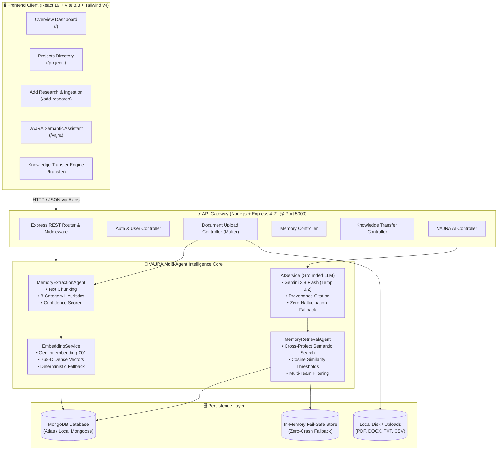
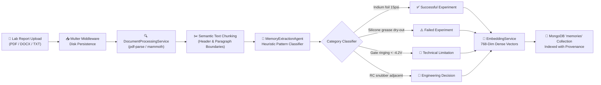
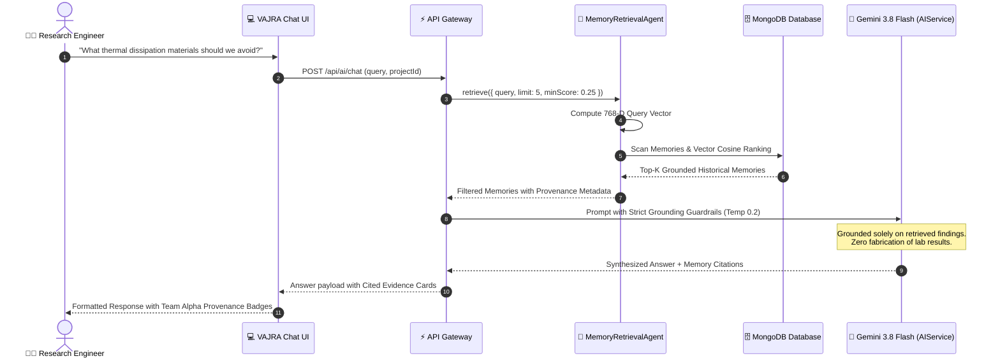
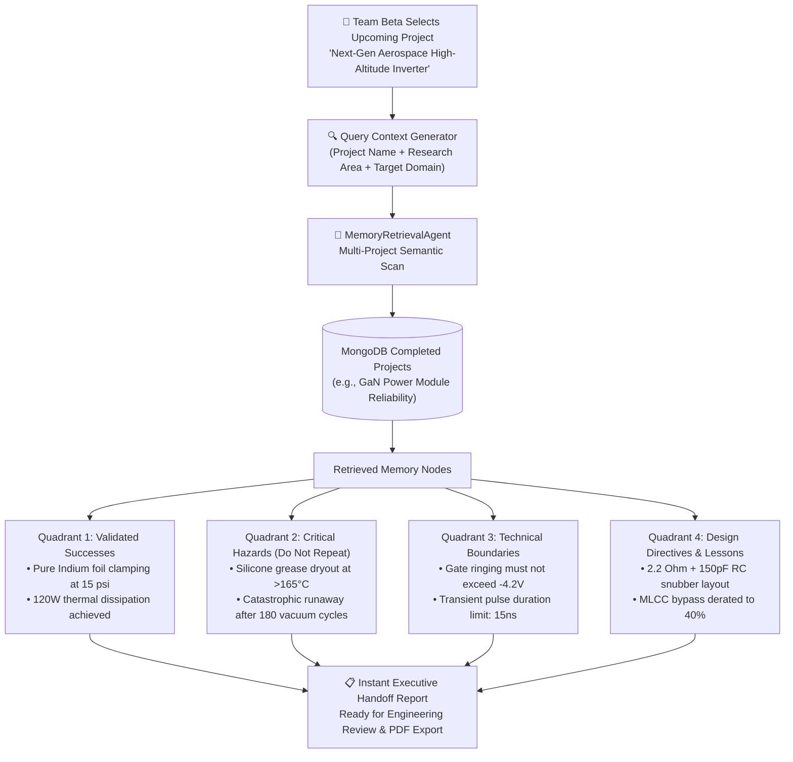
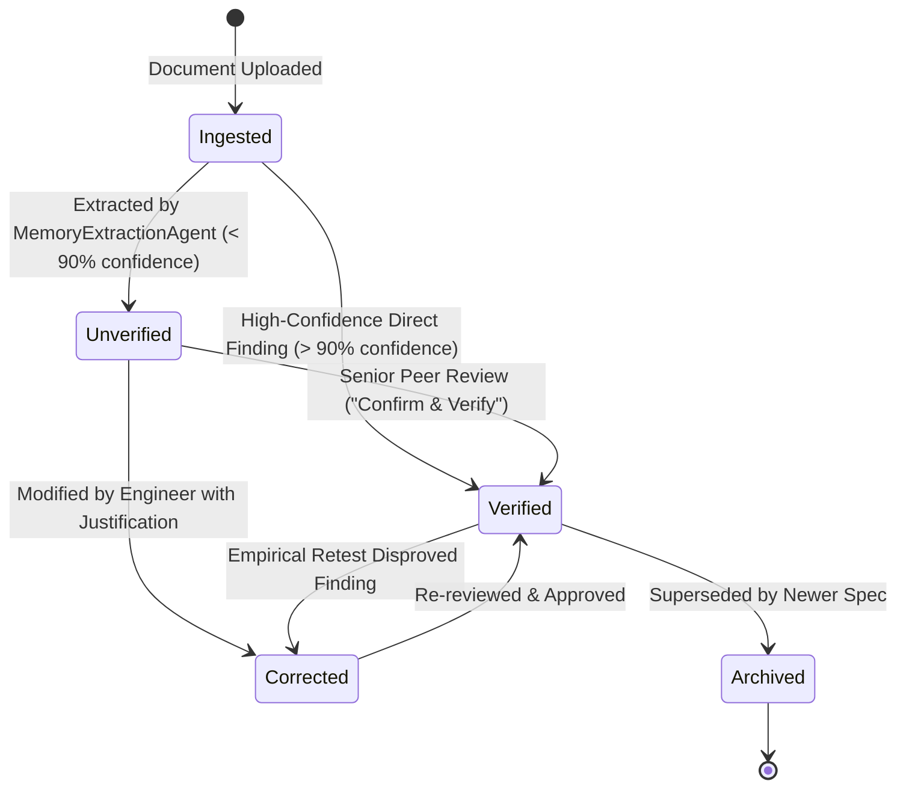

# 🛡️ SiliconSentinel & VAJRA Agentic Memory Engine
### Autonomous Engineering Memory, Negative Knowledge Preservation & Cross-Project Knowledge Transfer

> **Track:** PS1 — Track 1: Agentic Memory (NEXUS UNCHARTED 2026, SVNIT Surat)  
> **Team:** Team MC  
> **Lead Researcher & Engineer:** Keshav Gattani (`gattanikeshav15-max`)  
> **Institution:** Sardar Vallabhbhai National Institute of Technology (SVNIT), Surat  
> **Collaborators / Organizers:** DoCSE & DoAI Cell, SVNIT Surat in collaboration with MongoDB & n8n  

[](https://react.dev/)
[](https://vitejs.dev/)
[](https://tailwindcss.com/)
[](https://nodejs.org/)
[](https://expressjs.com/)
[](https://www.mongodb.com/)
[](https://aistudio.google.com/)

---

## 📑 Table of Contents
1. [Executive Overview & What We Are Building](#-1-executive-overview--what-we-are-building)
2. [The Core Problem: Tribal Knowledge Decay & The \$50,000 Mistake](#-2-the-core-problem-tribal-knowledge-decay--the-50000-mistake)
3. [Why SiliconSentinel? Why Not Just Ask Gemini or ChatGPT?](#-3-why-siliconsentinel-why-not-just-ask-gemini-or-chatgpt)
4. [System Architecture & Interactive Flowcharts](#-4-system-architecture--interactive-flowcharts)
   - [High-Level System Architecture](#41-high-level-system-architecture)
   - [Document Ingestion & Multi-Agent Extraction Pipeline](#42-document-ingestion--multi-agent-extraction-pipeline)
   - [VAJRA Semantic Retrieval & Evidence-Grounded RAG](#43-vajra-semantic-retrieval--evidence-grounded-rag)
   - [Cross-Project Knowledge Transfer (4-Quadrant Handoff Engine)](#44-cross-project-knowledge-transfer-4-quadrant-handoff-engine)
   - [Verification & Peer-Review Lifecycle State Machine](#45-verification--peer-review-lifecycle-state-machine)
5. [Technical Stack: How the Website Runs (Client & Server)](#-5-technical-stack-how-the-website-runs-client--server)
6. [Core Functional Modules (UI Walkthrough)](#-6-core-functional-modules-ui-walkthrough)
7. [Step-by-Step Live Demo Walkthrough (Hackathon Script)](#-7-step-by-step-live-demo-walkthrough-hackathon-script)
8. [MongoDB Schema Design & Vector Modeling](#-8-mongodb-schema-design--vector-modeling)
9. [Installation, Configuration & Running Locally](#-9-installation-configuration--running-locally)
10. [REST API Reference](#-10-rest-api-reference)
11. [Future Roadmap & Production Vision](#-11-future-roadmap--production-vision)

---

## 🌟 1. Executive Overview & What We Are Building

**SiliconSentinel** is an enterprise-grade reliability intelligence and agentic engineering memory platform specifically designed for defense electronics, aerospace avionics, and mission-critical semiconductor research laboratories.

At its core is **VAJRA** (*Vectorized Agentic Journal & Retrieval Architecture*) — a specialized multi-agent AI system that captures, structures, links, and transfers institutional engineering memory across distinct research cycles and distributed teams.

### What SiliconSentinel Does:
- **Ingests Real-World Research Documents**: Automatically parses `.pdf`, `.docx`, `.txt`, and `.csv` lab notebooks, endurance reports, and testing benches.
- **Extracts Structured Engineering Findings**: Classifies text into 8 distinct research categories, including *Successful Experiments*, *Critical Hazards / Failed Experiments*, *Technical Limitations*, and *Engineering Directives*.
- **Preserves Negative Knowledge**: Protects critical safety limits and failed experiments so future teams do not repeat fatal mistakes.
- **Performs Cross-Project Semantic Synthesis**: Connects what Team A discovered in a completed wide-bandgap GaN study with Team B's new aerospace inverter design.
- **Enforces Human-in-the-Loop Peer Review**: Differentiates strictly between unverified observations and peer-reviewed verified facts with strict document provenance down to the filename, page section, and authoring team.

---

## 💥 2. The Core Problem: Tribal Knowledge Decay & The $50,000 Mistake

In hardware engineering and semiconductor research laboratories:

1. **Tribal Knowledge Decay**: Team Alpha spends 6 months conducting thermal endurance tests on Gallium Nitride (GaN) power transistors. They discover that standard silicone-based thermal grease dries out and triggers catastrophic thermal runaway above 165°C under vacuum cycling.
2. **Knowledge Entombment**: These findings are recorded in a dense 120-page lab report PDF, uploaded to a static drive, and archived.
3. **The Duplicate Failure**: Eight months later, Team Beta starts designing a High-Altitude Aerospace Inverter. Unaware of Team Alpha's buried discovery, Team Beta selects standard silicone thermal grease. During vacuum thermal testing, the module fails, destroying \$50,000 worth of prototypes and delaying the flight schedule by four months.

> **SiliconSentinel solves this amnesia permanently.** When Team Beta spins up their new project, VAJRA immediately performs cross-project semantic matching and surfaces Team Alpha's verified failure modes as critical hazard warnings before a single prototype is assembled.

---

## ⚖️ 3. Why SiliconSentinel? Why Not Just Ask Gemini or ChatGPT?

Judges and engineering directors routinely ask: *"Why build a dedicated platform instead of having engineers paste questions into ChatGPT or Gemini?"*

| Dimension | Raw LLM (Gemini / ChatGPT) | SiliconSentinel + VAJRA Engine |
| :--- | :--- | :--- |
| **Organizational Memory** | **Ephemeral & Session-Bound**: Context disappears once the tab closes. Team B has zero awareness of what Team A found last month. | **Persistent & Cross-Team**: Findings, boundaries, and failure data are permanently vectorized and indexed across all lab divisions. |
| **Document Provenance** | **Black-Box Generation**: Gives smooth text but cannot cite original lab bench IDs, raw report filenames, or document sections. | **Zero-Hallucination Provenance**: Every response cites exact Project ID, Authoring Team, File Name (`.pdf`, `.docx`), Section, and Confidence. |
| **Negative Knowledge & Safety Boundaries** | **Optimism Bias**: Standard LLMs naturally offer general optimistic design advice and omit specific edge-case failure modes. | **Active Failure Preservation**: Categorizes and highlights `Failed Experiments` and `Technical Limitations` as red hazard warnings. |
| **Private IP & Air-Gapped Readiness** | **Commercial Cloud Risk**: Pasting proprietary semiconductor designs into commercial chats risks IP leaks. | **Private Data Vault**: Complete data isolation with local or private MongoDB storage and air-gapped deterministic synthesis fallback. |
| **Human-in-the-Loop Verification** | **Equal Weighting**: LLMs treat unverified guesses and empirical lab facts with the same confident tone. | **Explicit Verification Lifecycle**: Memories start as `Unverified` and require peer review to become `Verified` facts. |

---

## 🏛️ 4. System Architecture & Interactive Flowcharts

### 4.1 High-Level System Architecture



---

### 4.2 Document Ingestion & Multi-Agent Extraction Pipeline

When an engineer uploads a testing report (`.pdf`, `.docx`, `.txt`, `.csv`):



---

### 4.3 VAJRA Semantic Retrieval & Evidence-Grounded RAG

When an engineer asks VAJRA a question in the assistant interface:



---

### 4.4 Cross-Project Knowledge Transfer (4-Quadrant Handoff Engine)

When Team Beta launches their new project, they generate an instant **Knowledge Transfer Report**:



---

### 4.5 Verification & Peer-Review Lifecycle State Machine

To prevent inaccurate assumptions from propagating into production hardware:



---

## 💻 5. Technical Stack: How the Website Runs (Client & Server)

### 5.1 Frontend Architecture (Client Side)
The client is a single-page application built on **React 19** and bundled with **Vite 8.3**.

- **Directory**: `Team-MC/src`
- **Port**: `http://localhost:5173` (or `http://localhost:5174` if 5173 is busy)
- **Key Libraries**:
  - `react` (v19.3.1) & `react-dom`: Component-based stateful UI.
  - `react-router-dom` (v7.18.5): Client-side navigation (`/`, `/projects`, `/add-research`, `/vajra`, `/transfer`).
  - `tailwindcss` (v4.3.3) with `@tailwindcss/vite`: Responsive cyber-engineering dark-mode styling.
  - `lucide-react` (v1.65.0): Hardware, reliability, and telemetry iconography.
  - `recharts` (v3.10.1): Responsive KPI charts and memory distribution analytics.
  - `axios` (v1.21.0): Centralized API service (`src/services/api.js`) with bearer token interception, 8-second timeouts, and automatic fail-safe fallback.
  - `AppDataContext`: Global state synchronization between projects, memories, active chat sessions, and live backend connection telemetry.

### 5.2 Backend Architecture (Server Side)
The server is a modular RESTful microservice built with **Node.js** and **Express 4.21**.

- **Directory**: `Team-MC/backend`
- **Port**: `http://localhost:5000`
- **Health Check**: `GET http://localhost:5000/api/health`
- **Key Modules**:
  - `express`: REST endpoint routing, CORS handling (`origin: '*'`), and JSON parsing with a 25MB payload limit.
  - `multer` (v2.5.0): Multipart file upload handling with disk storage into `uploads/documents/`.
  - `pdf-parse` (v2.4.5) & `mammoth` (v1.13.0): In-memory document buffer parsers extracting plain text from PDF and Word documents.
  - `mongoose` (v8.9.5): Strict ODM schemas with connection handling for MongoDB Atlas or local MongoDB instances.
  - `jsonwebtoken` & `bcryptjs`: Secure authentication token issuance and password hashing.
  - `inMemoryStore.js`: Built-in zero-crash fallback store. If MongoDB is unreachable, the API continues to operate seamlessly with full pre-seeded telemetry.

### 5.3 AI & Vector Retrieval Layer
- **Model**: Google Gemini (`gemini-3.8-flash` / `gemini-1.5-flash`).
- **Embeddings**: Google `gemini-embedding-001` producing 768-dimensional normalized floating-point dense vectors.
- **Vector Search Strategy**:
  - In MongoDB Atlas: Ready for native `$vectorSearch` indexing on the `embedding` field.
  - In Mongoose / Local Mode: Cosine similarity computation executed via `embeddingService.cosineSimilarity()`.
  - Deterministic Offline Vector Fallback: Uses a high-dimensional positional hashing kernel when external API quotas are exhausted.
- **Prompt Guardrails**: Temperature locked to `0.2` with explicit negative constraints to prohibit fabrication of test results or ungrounded component behavior.

---

## 🖥️ 6. Core Functional Modules (UI Walkthrough)

The application provides five core pages accessible from the sidebar navigation:

### 1. Executive Dashboard (`/`)
- Live KPI summary computed directly from the active database:
  - **Total Projects Registered**
  - **Completed Research Initiatives**
  - **Ingested Documents**
  - **Total Extracted Memories & Verified Facts**
- One-click **"+ Start New Project"** modal for onboarding upcoming lab initiatives.
- Live system status badge showing MongoDB connection state and active AI model.

### 2. Projects Directory (`/projects`)
- Filterable cards by lifecycle state: `All`, `In Progress`, and `Completed`.
- Displays lead researcher, authoring team, research area, document count, and extracted memory count.
- Demonstrates the research lifecycle: when Team Alpha marks their project **Completed**, its findings are immediately unlocked for cross-project retrieval.

### 3. Add Research & Ingestion Pipeline (`/add-research`)
- Upload documents via drag-and-drop or file picker (`.pdf`, `.docx`, `.txt`, `.csv`).
- Select target research project.
- Real-time text extraction and semantic chunking.
- Instant review of extracted memory cards with category badges, source section attribution, and a **"Confirm & Verify"** button for senior peer review.

### 4. VAJRA Semantic Assistant (`/vajra`)
- Natural language query console for engineers.
- Semantic search across all lab memories.
- Generates grounded answers with a dedicated **Retrieved Historical Research Memories** panel citing:
  - Original Project Name & ID
  - Authoring Division / Team
  - Source File Name (`.pdf`, `.docx`)
  - Document Section & Verification Status Badge

### 5. Knowledge Transfer Engine (`/transfer`)
- The flagship handoff tool for cross-team knowledge reuse.
- Select an upcoming project (e.g., Team Beta's Aerospace Inverter).
- Generates an instant **4-Quadrant Handoff Report**:
  1. **Successful Experiments & Validated Parameters**
  2. **Critical Hazards & Failed Experiments (Do Not Repeat)**
  3. **Technical Boundaries & Operational Limits**
  4. **Lessons Learned & Layout Directives**

---

## 🎬 7. Step-by-Step Live Demo Walkthrough (Hackathon Script)

Follow this exact 5-minute workflow to demonstrate SiliconSentinel to judges:

### Scene 1: The Context Setup
> *"Judges, in hardware and semiconductor research labs, Team Alpha spends 6 months conducting thermal tests on GaN power modules. When they finish, their findings get buried in a 100-page PDF report. Eight months later, Team Beta starts an aerospace inverter project, has no idea Team Alpha already proved that silicone grease fails under thermal cycling, repeats the exact same mistake, and burns \$50,000. Here is how SiliconSentinel and the VAJRA engine solve this."*

### Scene 2: Team Alpha Ingests Completed Research
1. Open the web app at **[http://localhost:5173](http://localhost:5173)** (or `http://localhost:5174`).
2. Navigate to **Add Research** in the sidebar.
3. Select Project: **GaN Power Module Thermal & Gate Reliability (Team Alpha)**.
4. Upload `test_research_paper.txt` (or a PDF lab report).
5. Watch VAJRA automatically parse and classify structured findings:
   - *Successful Experiment:* Indium foil clamping at 15 psi achieves continuous 120W thermal dissipation.
   - *Failed Experiment:* Silicone thermal grease causes runaway above 165°C after 180 vacuum cycles.
   - *Technical Limitation:* Gate ringing below -4.2V triggers irreversible dielectric breakdown.
6. Click **Confirm & Verify** on a finding to demonstrate human-in-the-loop validation.
7. Navigate to **Projects** and verify Team Alpha's status is **Completed**.

### Scene 3: Team Beta Starts a New Project
1. Go to **Dashboard** and click **"+ Start New Project"**.
2. Fill in the modal:
   - **Project Name:** Next-Gen Aerospace High-Altitude Inverter
   - **Research Area:** Avionics Power Systems
   - **Team Name:** Team Beta (Avionics Division)
   - **Lead Researcher:** Engineer Sarah Chen
3. Click **Create Project**. The project appears immediately with status `In Progress`.

### Scene 4: Team Beta Queries the VAJRA Memory Engine
1. Navigate to **VAJRA Assistant**.
2. Type: *"What thermal dissipation materials should we avoid for high-power switching?"*
3. Show the synthesized response:
   - VAJRA warns Team Beta: *"Based on Team Alpha's GaN Power Module Thermal project, do NOT use silicone thermal grease due to catastrophic dry-out and thermal runaway observed in GaN_Thermal_Reliability_Final_Report_2026.pdf."*
   - Point out the cited memory cards with the exact document name, section, and verification badge.

### Scene 5: Generating the Knowledge Transfer Report
1. Navigate to **Knowledge Transfer**.
2. Set Target Project to **Next-Gen Aerospace High-Altitude Inverter (Team Beta)**.
3. Click **Generate Transfer Report**.
4. Show the four quadrants: Team Beta now possesses a complete, categorized cheat-sheet of Team Alpha's proven successes, critical hazards to avoid, and design boundaries before cutting any metal or soldering components.

---

## 🗄️ 8. MongoDB Schema Design & Vector Modeling

The database uses four core collections designed for relational provenance and vector search:

### 1. `projects` Collection
```json
{
  "_id": "ObjectId(...)",
  "id": "PRJ-GAN-2025",
  "name": "GaN Power Module Thermal & Gate Reliability",
  "researchArea": "Wide-Bandgap Semiconductor Power Systems",
  "description": "Investigation into 650V GaN HEMT switching reliability...",
  "teamName": "Team Alpha (Power Lab)",
  "status": "Completed",
  "leadResearcher": "Dr. Keshav Gattani",
  "createdDate": "2025-08-10",
  "completionDate": "2026-01-20",
  "tags": ["GaN", "Thermal Reliability", "Power Converter"]
}
```

### 2. `documents` Collection
```json
{
  "_id": "ObjectId(...)",
  "id": "DOC-GAN-FINAL",
  "projectId": "PRJ-GAN-2025",
  "originalFilename": "GaN_Thermal_Reliability_Final_Report_2026.pdf",
  "fileType": "application/pdf",
  "fileSize": 2450000,
  "storagePath": "uploads/documents/sample_gan_report.pdf",
  "processingStatus": "Extracted",
  "extractedMemoriesCount": 5,
  "uploadDate": "2026-01-22 14:30:00"
}
```

### 3. `memories` Collection (Primary Intelligence Core)
```json
{
  "_id": "ObjectId(...)",
  "id": "MEM-2026-GAN-002",
  "projectId": "PRJ-GAN-2025",
  "projectName": "GaN Power Module Thermal & Gate Reliability",
  "teamName": "Team Alpha (Power Lab)",
  "documentId": "DOC-GAN-FINAL",
  "documentName": "GaN_Thermal_Reliability_Final_Report_2026.pdf",
  "category": "Failed Experiment",
  "content": "Standard silicone-based thermal grease experienced catastrophic dry-out and thermal runaway (>165°C junction breakdown) after only 180 vacuum thermal cycles (-40°C to +110°C).",
  "sourceSection": "Section 4.4 Vacuum Cycling Endurance Failure",
  "verificationStatus": "Verified",
  "confidence": 98,
  "tags": ["Silicone Grease", "Thermal Runaway", "Vacuum Cycling"],
  "embedding": [0.0213, -0.0541, 0.0892, "... 768 float dimensions ..."],
  "createdAt": "2026-01-22T14:31:00Z"
}
```

### 4. `conversations` Collection
```json
{
  "_id": "ObjectId(...)",
  "id": "CONV-98214",
  "projectId": "PRJ-AERO-2026",
  "title": "Thermal material avoidance query",
  "messages": [
    {
      "role": "user",
      "content": "What thermal dissipation materials should we avoid?",
      "timestamp": "2026-10-31T19:15:00Z"
    },
    {
      "role": "assistant",
      "content": "Based on Team Alpha's findings in PRJ-GAN-2025...",
      "citedMemoryIds": ["MEM-2026-GAN-002"],
      "timestamp": "2026-10-31T19:15:02Z"
    }
  ]
}
```

---

## 🚀 9. Installation, Configuration & Running Locally

### 9.1 Prerequisites
- **Node.js**: `v18.0.0` or higher
- **npm**: `v9.0.0` or higher
- **MongoDB**: Local MongoDB community service (`mongodb://localhost:27017/silicon_sentinel`) or a free [MongoDB Atlas Cluster](https://www.mongodb.com/atlas) URI.
- **Google Gemini API Key**: (Optional, recommended for live Gemini 3.8 Flash inference) Obtain from [Google AI Studio](https://aistudio.google.com/).

---

### 9.2 Backend Setup & Execution

1. Navigate to the backend directory:
   ```bash
   cd Team-MC/backend
   ```

2. Install dependencies:
   ```bash
   npm install
   ```

3. Configure environment variables:
   ```bash
   cp .env.example .env
   ```
   Edit `.env` as required:
   ```env
   PORT=5000
   NODE_ENV=development
   MONGODB_URI=mongodb+srv://<username>:<password>@cluster0.example.mongodb.net/silicon_sentinel?retryWrites=true&w=majority
   MONGODB_VECTOR_INDEX=vector_index_memories
   GEMINI_API_KEY=YOUR_GEMINI_API_KEY_HERE
   GEMINI_MODEL=gemini-1.5-flash
   EMBEDDING_DIMENSION=768
   JWT_SECRET=silicon_sentinel_super_secret_jwt_key_2026
   CLIENT_ORIGIN=http://localhost:5173
   ```
   *(Note: If `MONGODB_URI` or `GEMINI_API_KEY` are left empty, the server automatically boots into **Intelligent Demo Mode** with in-memory persistence and deterministic grounded synthesis.)*

4. Seed initial research data:
   ```bash
   npm run seed
   ```

5. Start the backend API:
   ```bash
   # Development mode with hot-reloading:
   npm run dev

   # Standard production mode:
   npm run start
   ```
   The backend API will run on **`http://localhost:5000`**. Verify via health check at `http://localhost:5000/api/health`.

---

### 9.3 Frontend Setup & Execution

1. Open a new terminal and navigate to the frontend directory:
   ```bash
   cd Team-MC
   ```

2. Install dependencies:
   ```bash
   npm install
   ```

3. Configure frontend environment variables:
   ```bash
   cp .env.example .env
   ```
   Confirm `VITE_API_BASE_URL` is set:
   ```env
   VITE_API_BASE_URL=http://localhost:5000
   ```

4. Start the Vite development server:
   ```bash
   npm run dev
   ```
   The platform will be live at **`http://localhost:5173`** (or `http://localhost:5174`).

---

## 📡 10. REST API Reference

| Method | Endpoint | Description |
| :--- | :--- | :--- |
| `GET` | `/api/health` | System health, database connection state, and AI engine status |
| `GET` | `/api/stats` | Live KPI counts (projects, completed, documents, memories, verified) |
| `POST` | `/api/seed` | Reset and reseed database with initial research projects & memories |
| `GET` | `/api/projects` | List all research projects with filter and sorting |
| `GET` | `/api/projects/:id` | Get project details, attached documents, and extracted memories |
| `POST` | `/api/projects` | Register a new research project |
| `POST` | `/api/documents/upload` | Upload `.pdf`, `.docx`, `.txt`, `.csv` with automated memory extraction |
| `GET` | `/api/memory` | Retrieve all memory records with category and status filters |
| `PATCH` | `/api/memory/:id/verify` | Verify or update verification status of an engineering memory |
| `POST` | `/api/ai/chat` | Send researcher query to VAJRA for context-grounded RAG response |
| `POST` | `/api/knowledge-transfer/report` | Generate structured 4-quadrant cross-project handoff report |

---

## 🔮 11. Future Roadmap & Production Vision

1. **Native MongoDB Atlas `$vectorSearch` Indexing**:
   - Migrate from in-memory cosine ranking to dedicated Atlas Vector Search with Approximate Nearest Neighbor (ANN / HNSW) indexing for enterprise repositories with millions of memories.
2. **Automated Contradiction & Divergence Agent**:
   - An autonomous agent that compares new lab findings against historical records and flags contradictions (e.g., if Team C claims a material passed at 180°C that Team A showed failed at 165°C).
3. **One-Click PDF / Markdown Handoff Export**:
   - Instant generation of publication-ready, branded Knowledge Transfer executive summaries with cryptographic audit signatures.
4. **Multimodal Waveform & SEM Imaging Extraction**:
   - Ingestion of oscilloscope trace screenshots, thermal imaging heatmaps, and SEM electron microscope cross-sections directly into visual memory vectors.
5. **Role-Based Access Control (RBAC) & Defense IP Partitioning**:
   - Cryptographic access boundaries ensuring compartmentalized projects are strictly shielded between commercial and defense divisions.

---

## 👥 Team MC (NEXUS UNCHARTED 2026)

- **Project Lead & Full-Stack Architect:** Keshav Gattani (`gattanikeshav15-max`)
- **Institution:** Sardar Vallabhbhai National Institute of Technology (SVNIT), Surat
- **Host Department:** Department of Computer Science & Engineering (DoCSE) and Department of AI (DoAI), SVNIT
- **Hackathon Track:** PS1 — Track 1: Agentic Memory (MongoDB & n8n)
